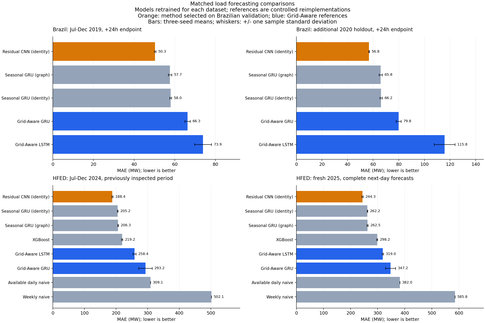

# Brazilian comparison and Canadian extension

The main comparison trains both methods in Brazil, then retrains the same
architecture on HFED. Trained weights are not transferred between countries.
The full original pilot remains in `results/grid_aware_pilot_seed42/`.

## Brazilian comparison

Pinned dynamic data: [Zenodo V2](https://zenodo.org/records/18595751), MD5
`f5003d072297deea746f63ff59ed4e47`. Static node attributes come from
[V1](https://zenodo.org/records/17175783) and exactly match their V2 counterparts.
The old V1 dynamic file covers only 2019–2020 and cannot supply the training years.

Train 2017–2018, validate Jan–Jun 2019, evaluate Jul–Dec 2019, and additionally
evaluate 2020 as an additional holdout. Predict +1, +6, +24 hour endpoints using the paper's
24-hour input window. The seasonal methods additionally receive seven daily
load lags and known target calendars; this information difference is explicit.

Five methods, seeds 42/123/456:

- Frozen multiscale GAT plus LSTM, published Table 2 dimensions/learning rate.
- Frozen multiscale GAT plus GRU, published Table 2 dimensions/learning rate.
- Seasonal residual GRU with an identity graph (own static attributes only).
- The same seasonal residual GRU with the original physical graph.
- The project's existing identity residual convolution model.

The residual CNN consumes past load, observation masks, seasonal lags and known
target calendars. It does not consume weather. The recurrent seasonal candidates
consume the complete historical dynamic feature set. Improvements therefore do
not establish a weather benefit; the HFED weather/calendar ablations use the
seasonal GRU to measure those additions with a fixed architecture.

Reference models minimize MSE with global training-only robust scaling. Residual
models use their existing per-region scaling and SmoothL1 objective. The extension
preserves the paper's frozen graph and GRU; it adds a horizon-wise residual head
conditioned on causal seasonal lags and target calendars. The identity control
has the same capacity, feature set, and training procedure as the graph extension.

All recurrent models optimize batches of **32 individual state forecasts**. The
pilot used 1,728, which was a substantial optimization mismatch. Brazilian CUDA replay groups
64 sequential updates to reduce host overhead; it does not accumulate gradients
or increase optimization batch size. Tests verify independent Adam updates and
partial-batch handling. Reference diagnostic validation results match the single
update execution to rounding precision.

Maximum 200 epochs; ReduceLROnPlateau factor 0.1/patience 5; early stopping patience
10; checkpoint selection uses validation objective only. No Optuna search is
claimed: references use the paper's reported selected hyperparameters. Single-layer
recurrent dropout is absent, matching the executable semantics of the author's
single-layer LSTM snippet. The GRU dropout placement is not fully specified by the
available source. Frozen embeddings are cached in eval mode for all nodes and
serialized; these corrections differ from inconsistent published snippets.

The run plan and source snapshots are written before training. No test predictions
are generated during fitting. Select the extension with lowest mean 24h validation
MAE across the three seeds before evaluating test periods. Report every predeclared
method, mean/std by seed, and paired seven-day block confidence intervals.

The primary comparison is the validation-selected candidate's 24-hour MAE against
both reimplemented references on Jul–Dec 2019. Evidence for an improvement requires
lower MAE for every seed and a paired 95% interval entirely below zero against
each reference. The unused 2020 period checks whether that improvement persists.
Other candidates, horizons, and subgroup comparisons are descriptive analyses;
their intervals are unadjusted and are not additional independent confirmations.
Block intervals resample paired dates after averaging error differences over the
three fixed seeds; they quantify date variation conditional on these runs. Seed
standard deviations and per-seed wins are reported separately.

The primary inferential comparison is against the reimplemented references on
identical held-out keys. Table 3's historical scores are shown separately; differing
curation/source-code ambiguities prevent a claim of bitwise original replication.

```powershell
.venv/Scripts/python.exe scripts/download_grid_aware.py
.venv/Scripts/python.exe scripts/run_logged.py results/grid_aware_confirm_v3.log scripts/confirm_grid_aware.py fit --output results/grid_aware_confirm_v3 --models grid_aware_lstm grid_aware_gru seasonal_identity seasonal_grid_aware residual_identity --seeds 42 123 456 --epochs 200 --sample-batch 32 --residual-batch-times 32 --patience 10 --include-2020 --capture-steps 64
.venv/Scripts/python.exe scripts/select_brazil_method.py --results results/grid_aware_confirm_v3
.venv/Scripts/python.exe scripts/confirm_grid_aware.py evaluate --output results/grid_aware_confirm_v3 --models grid_aware_lstm grid_aware_gru seasonal_identity seasonal_grid_aware residual_identity --seeds 42 123 456 --include-2020
.venv/Scripts/python.exe scripts/report_cross_dataset.py --results results/grid_aware_confirm_v3 --kind brazil
```

Incomplete `batch32`/`capture`/`confirm_v1` diagnostic directories contain validation
work, not additional independent test results. They must not be pooled with V2.
The V2 fit was resumed after a checkpoint file-write failure. Atomic serialized
checkpoints now preserve the prior state until replacement succeeds. Resume
checks require unchanged feature/state order and exactly equal fitted scalers;
JSON normalization preserves the original split settings when tuples reload as
lists. Source snapshots and pre-recovery summaries retain this execution history.

The corrected V3 imports only the three unaffected eager CNN fits from V2.
`import_unaffected_brazil_cnn.py` checks the original configuration, architecture
and adapter definitions, float-LR uncaptured optimizer state, completed stopping,
and history consistency. Copied files and SHA-256 hashes are recorded in
`imported_fits.json` and the frozen plan. All twelve captured recurrent fits are
retrained using the corrected scheduler. Training from scratch without this
optional import remains supported by the commands above.

## HFED extension

Data include the existing processed HFED history, native Newfoundland readings,
new official 2025 demand downloads, cached Canadian holidays, and official ECCC
hourly station observations at one representative station per province. Stations
are selected by distance and 2019 weather completeness; no demand labels or future
forecast errors influence station selection.

- Train on forecast dates before 2024; validate Jan–Jun 2024.
- Report the previously inspected Jul–Dec 2024 period separately from the fresh
  2025 available-observation holdout. Province coverage is uneven; report counts.
- Issue at 23:00 local and predict all 24 next-day hours. Treat load as hourly
  intervals; newest input ends at issue time. Do not use the unfinished 23:00 bucket.
  Load is assumed available at interval end; exact historical HFED publication
  delays and revision vintages are not reproduced by these archived observations.
- Purge the final training and validation forecast days whose target intervals
  finish after the earliest next-period issue across all provinces. Fit scaler
  statistics only to training-period observations available by the first validation issue.
- Rebuild Newfoundland hours on its :30 UTC grid rather than mislabeling local
  :30 observations as top-of-hour local targets. Explicitly exclude 23/25-hour DST
  days from this fixed-24-output experiment. Never impute evaluation labels.
  Newfoundland history and fresh native demand use the mean of available
  within-hour readings; whole missing hours stay missing. This extension adds
  no further intra-hour completeness threshold to those native readings.
- Fit all scalers and graph-independent statistics on the Canadian training period.
- HFED supplies no original-paper renewable-potential/capacity attributes. Use
  documented coordinates and geographic edges with distance attributes; do not
  invent electrical capacities. This is an HFED adaptation of Grid-Aware.
- Use exact or at most 30-minute earlier station observations, never interpolate
  from future weather. Assume a one-hour reporting buffer; archived corrections
  and exact publication timestamps are not reproduced. One station is a proxy,
  not spatially aggregated province-wide weather. Downloaded ERA5 data are retained
  as optional retrospective data and are not the primary model inputs.
- Evaluate demand-only, demand+weather, and demand+weather+calendar variants,
  with the matched identity control for incremental graph value.
- Report provincial and peak-demand errors, plus cold/hot conditions at issue.
  Cold/hot thresholds are the training-only provincial 5th/95th percentiles of
  observed 24-hour input temperature, requiring at least 12 observations. These
  labels describe conditions at issue rather than realized target-day extremes.
- Retrain XGBoost (500 trees, depth 6, validation early stopping) on matched causal
  examples, plus available-daily-lag and weekly naive controls. XGBoost receives
  past demand, past-weather summaries, seasonal lags, known calendars and region
  indicators. It does not receive target labels or realized target-day weather.

Prepared examples: 10,317 train, 1,416 validation, 1,297 test2024, and 2,382
test2025 province-days. These are matched sample counts, not complete years in
every province. Detailed per-region counts are available in the cached records.

```powershell
.venv/Scripts/python.exe scripts/download_hfed_holdout.py
.venv/Scripts/python.exe scripts/download_eccc_weather.py
.venv/Scripts/python.exe scripts/prepare_hfed_benchmark.py
.venv/Scripts/python.exe scripts/benchmark_hfed_extension.py fit
.venv/Scripts/python.exe scripts/benchmark_hfed_extension.py evaluate
.venv/Scripts/python.exe scripts/report_cross_dataset.py --results results/hfed_extension_eccc_v4 --kind hfed
```

The additional weather/calendar ablations use `--models seasonal_identity` with
`--feature-set demand` and `--feature-set demand_weather` in separate output
directories. The complete-feature identity and graph counterparts are already in
the main experiment. Use `report_hfed_ablations.py` to compare the fixed feature
sequence and its paired uncertainty.

```powershell
.venv/Scripts/python.exe scripts/benchmark_hfed_extension.py fit --output results/hfed_ablation_demand_v4 --models seasonal_identity --feature-set demand
.venv/Scripts/python.exe scripts/benchmark_hfed_extension.py fit --output results/hfed_ablation_weather_v4 --models seasonal_identity --feature-set demand_weather
.venv/Scripts/python.exe scripts/benchmark_hfed_extension.py evaluate --output results/hfed_ablation_demand_v4 --models seasonal_identity --feature-set demand
.venv/Scripts/python.exe scripts/benchmark_hfed_extension.py evaluate --output results/hfed_ablation_weather_v4 --models seasonal_identity --feature-set demand_weather
.venv/Scripts/python.exe scripts/report_hfed_ablations.py --full results/hfed_extension_eccc_v4 --demand results/hfed_ablation_demand_v4 --weather results/hfed_ablation_weather_v4
.venv/Scripts/python.exe scripts/plot_cross_dataset.py
```

The primary HFED output is `results/hfed_extension_eccc_v4`, using the unchanged
`data/processed/hfed_extension_eccc_v2` cache. V4 uses the same validated CUDA
replay mechanism as Brazil: sixteen sequential batch-32 updates, not a larger
batch. Capture warmup uses training indices only. Masked-label losses and all
four model architectures (including dropout) pass eager-versus-replay loss,
gradient, and optimizer-update parity checks. A real one-epoch CNN check reduced
runtime from 10.55 to 1.37 seconds and matched validation MAE within 0.00005 MW.
The partial eager V2 run and captured V3 run were stopped before any test
prediction; V3 was stopped after discovery of the scheduler storage bug. They
and the one-epoch speed diagnostic are preserved and are not pooled with V4. No data,
architecture, hyperparameter, or stopping rule changed for this optimization.
Training loss reporting averages optimization steps during replay; validation
continues to weight all available target observations exactly as in eager mode.

Every run uses a new output directory, preserves checkpoints and keyed predictions,
and refuses to overwrite an existing experiment. The deployment/dashboard models
are left unchanged until the new method has been evaluated.

## Corrected Brazilian results

These are the corrected V3 results. The earlier V2 comparison was superseded
after an audit found that PyTorch 2.6's plateau scheduler replaces a tensor LR
with a float while captured kernels keep reading the original tensor. All
twelve captured fits were retrained with `TensorPreservingPlateau`, whose
regression test verifies actual weight updates across reductions. The unaffected
eager CNN fits were imported with source/configuration checks and file hashes.
No superseded reference forecasts are pooled into the results below.

All fifteen declared fits completed. Validation selected `residual_identity`
before test evaluation (mean 24h validation MAE 55.15 MW). The following are
pooled +24h endpoint MAEs in MW, mean +/- sample standard deviation over three
seeds. All models use identical held-out keys: 117,963 observations per seed in
2019 and 235,899 in 2020.

The 2019 period was inspected in the earlier pilot. The 2020 period was unused
in that pilot but was inspected in V2 before the scheduler bug was found. Both
remain held out from fitting and method selection; neither is described as a
newly blinded V3 test. The execution correction did not change the candidates,
hyperparameters, or validation-based selection rule. HFED's unused 2025 period
provides the next independent holdout.

| Method | Jul-Dec 2019 | Additional 2020 holdout |
| --- | ---: | ---: |
| Grid-Aware LSTM | 73.92 +/- 4.16 | 115.84 +/- 8.14 |
| Grid-Aware GRU | 66.30 +/- 1.35 | 79.80 +/- 1.96 |
| Seasonal GRU, identity | 57.97 +/- 0.45 | 66.16 +/- 0.95 |
| Seasonal GRU, physical graph | 57.65 +/- 0.84 | 65.82 +/- 1.22 |
| Selected residual CNN, identity | **50.30 +/- 0.39** | **56.76 +/- 0.17** |

The selected CNN reduces MAE by 24.13% against the GRU reference in 2019 and
28.88% in 2020. Its paired MAE differences and seven-day block 95% intervals are
-16.00 MW [-20.10, -12.74] and -23.04 MW [-26.44, -19.71], respectively. It also
beats the LSTM reference in every seed, with intervals entirely below zero in
both periods. The predefined +24h MAE criterion is satisfied on the corrected
matched benchmark and persists on the additional 2020 period.

The CNN's 2019 +1h/+6h MAEs are 27.91/35.12 MW, versus the reference GRU's
32.57/53.10 MW. Its +1h RMSE is higher (65.36 versus 57.15 MW), so the
results do not support superiority on every metric at every horizon.

The graph-preserving seasonal extension also beats the corrected GRU reference:
13.04% lower +24h MAE in 2019 and 17.53% in 2020, in every seed, with paired
intervals entirely below zero. This is an improvement to the full forecasting
system, which includes additional seasonal inputs and regional scaling.

The graph GRU improves mean MAE over its identity control by about 0.55% in 2019
and 0.53% in 2020. The 2019 improvement does not occur in every seed, and the
2020 paired interval includes zero. These results do not establish a robust
incremental graph benefit.

For context, [Table 3 of the paper](https://energy.acm.org/eir/grid-aware-spatio-temporal-graph-neural-networks-for-multi-horizon-load-forecasting/)
reports 24h GRU MAE/RMSE/MAPE of 63.70 MW / 146.30 MW / 4.54%. Our selected
CNN gives 50.30 / 128.67 / 1.98% in 2019. The numbers are lower, but the updated
data, incomplete [author code](https://github.com/ugoorji12/Grid-Aware_STGNN_for_Multi-Horizon_Load_Forecasting),
and explicit feature/training differences prevent an exact historical
replication claim. The matched reimplementations are the primary comparison.

Machine-readable evidence is in `results/grid_aware_confirm_v3/`: the frozen
`plan.json`, `method_selection.json`, per-seed metrics, paired comparisons,
source snapshots, best/latest checkpoints, and keyed forecast parquet files.

## HFED retraining results

The method selected in Brazil was trained from new initialization on HFED;
Brazilian weights were not transferred. All eight methods completed three seeds.
The following are complete-next-day forecast MAEs in MW, mean +/- seed sample
standard deviation. The 2024 period was previously inspected; 2025 was unused
for forecast evaluation until all main and ablation fits had finished.

| Method | Jul-Dec 2024 | Unused 2025 holdout |
| --- | ---: | ---: |
| Adapted Grid-Aware LSTM | 258.36 +/- 4.74 | 319.00 +/- 2.35 |
| Adapted Grid-Aware GRU | 293.18 +/- 21.36 | 347.25 +/- 18.63 |
| XGBoost | 219.19 +/- 1.91 | 298.18 +/- 1.63 |
| Available daily naive | 309.06 | 382.02 |
| Weekly naive | 502.13 | 585.78 |
| Seasonal GRU, identity | 205.23 +/- 1.40 | 262.21 +/- 0.86 |
| Seasonal GRU, geographic graph | 206.32 +/- 1.38 | 262.55 +/- 1.99 |
| Selected residual CNN, identity | **188.36 +/- 2.02** | **244.28 +/- 2.55** |

On 2025, the CNN's RMSE is 537.18 MW and MAPE is 3.44%. It reduces MAE by
23.43% against the stronger Grid-Aware reference (LSTM), 29.65% against the GRU,
and 18.08% against XGBoost. It wins each comparison in every seed. Paired MAE
differences and seven-day block 95% intervals are:

| Reference | CNN minus reference (MW) | 95% interval (MW) |
| --- | ---: | ---: |
| Grid-Aware LSTM | -74.73 | [-87.15, -64.13] |
| Grid-Aware GRU | -102.97 | [-117.47, -91.67] |
| XGBoost | -53.90 | [-70.69, -39.52] |

The 2025 comparison contains **56,809 available target hours over 2,382
province-days**. Coverage varies substantially; it is not a complete year for
every province. Missing target hours were excluded equally for all methods.

| Province | Forecast days | Observed target hours |
| --- | ---: | ---: |
| AB | 264 | 6,228 |
| BC | 363 | 8,704 |
| NB | 350 | 8,377 |
| NL | 255 | 6,052 |
| NS | 82 | 1,905 |
| ON | 363 | 8,707 |
| PE | 351 | 8,358 |
| QC | 354 | 8,478 |

The CNN has lower provincial mean MAE than the LSTM and XGBoost in all eight
provinces. At the training-defined peak thresholds, its 2025 peak MAE is 397.11
MW, versus 473.28 for LSTM and 497.55 for XGBoost; peak precision/recall are
0.896/0.834 over 11,471 peak observations. The graph seasonal GRU has slightly
lower peak RMSE (838.34 versus the CNN's 846.30 MW), so superiority is not
claimed for every metric or subgroup. The CNN's cold/hot-at-issue MAEs are
262.08/319.09 MW, versus 237.64 in typical conditions; these labels describe
known conditions at issue, not realized target-day extremes.

### Fixed-architecture feature ablations

These use the seasonal identity GRU throughout, retaining architecture,
initialization scheme, sample keys and training rules. The selected CNN does
not consume weather; its improvement cannot be attributed to weather inputs.

| GRU inputs | 2025 MAE (MW) |
| --- | ---: |
| Demand and causal seasonal lags | 322.19 +/- 1.73 |
| Add past weather | 295.67 +/- 1.17 |
| Add known calendars | 262.21 +/- 0.86 |
| Add geographic graph | 262.55 +/- 1.99 |

Weather reduces MAE by 8.23% (paired difference -26.52 MW, interval
[-34.82, -18.91]); calendars add an 11.32% reduction (-33.46 MW,
[-44.67, -24.39]). The graph adds no reliable gain: +0.34 MW
[-1.12, 1.85]. These are the predeclared descriptive ablations with unadjusted
intervals. They support weather/calendar value for this GRU, not a robust
incremental geographic-edge benefit.

All keyed predictions, seed/regional/peak/weather metrics, coverage, paired
comparisons and feature ablations are under `results/hfed_extension_eccc_v4/`.
The ablation checkpoints/predictions are in `results/hfed_ablation_demand_v4/`
and `results/hfed_ablation_weather_v4/`.



## Verification

51 focused test cases pass in the combined benchmark/dashboard regression run. They cover masked
loss/gradient parity, stochastic CUDA update parity, scheduled Adam and AdamW
updates, local-day/DST/Newfoundland alignment, causal weather/lag availability,
purged boundaries, matched forecast keys, paired reporting, XGBoost save/load,
atomic checkpoint writes, frozen plans, and exact CPU training resume. Changed
Python scripts/modules also pass compilation checks. GPU parity checks use
floating-point tolerances; exact cross-device reproducibility is not claimed.
The dashboard tests additionally cover all served checkpoints, the final partial
evaluation batch, causal date features, missing-actual forecasts and the five
Streamlit page/navigation/date-ablation interaction checks.

## Dashboard integration and supplementary proposal checks

`dashboard/app.py` now routes to the verified HFED forecasting/evidence pages in
`dashboard/benchmark_pages.py`. The date picker selects the forecast day, with
issuance at 23:00 local on the previous day. The service in
`src/data/benchmark_forecast.py` builds the same frozen-scale causal features and
loads the corresponding seed checkpoint for each model or ablation. It serves
all 24 hours even when target actuals are missing. Source options are the frozen
archive, fresh HFED/ECCC API observations, or native HFED CSV uploads. Historical
validation dates are labelled as validation; later API dates are not assigned
the 2025 aggregate accuracy. Forecast CSV downloads include province, forecast
date, issue/target timestamps and the selected member/ensemble.

The interface exposes overall/per-province MAE, RMSE and MAPE, actual/predicted
curves, training-percentile high-demand flags, input weather, peak precision/
recall, ablations, coverage, source plans and score downloads. Brazil appears
only as a 1h/6h/24h evidence view. Original Table 3 values are kept separate from
the controlled reruns, with the updated-data/code caveat and the 1h RMSE tradeoff.

Two additional proposal controls use pooled own-history LSTM/GRU models with
region identifiers and no graph/static embeddings. Dimensions/rates are fixed
from the published RNN settings; checkpoints use validation only. These controls
were added **after the primary test results were inspected** and are descriptive
supplementary comparisons, not new blinded confirmations. Their 2025 MAEs are
313.13 +/- 6.65 MW (LSTM) and 322.34 +/- 3.39 MW (GRU), versus the already-selected
CNN's 244.28 +/- 2.55 MW. Paired intervals and matching keys are stored separately
in `results/hfed_temporal_controls_v1/paired_with_selected.json`.

```powershell
.venv/Scripts/python.exe scripts/benchmark_hfed_extension.py fit --output results/hfed_temporal_controls_v1 --models temporal_lstm temporal_gru
.venv/Scripts/python.exe scripts/benchmark_hfed_extension.py evaluate --output results/hfed_temporal_controls_v1 --models temporal_lstm temporal_gru
.venv/Scripts/python.exe scripts/report_cross_dataset.py --results results/hfed_temporal_controls_v1 --kind hfed
.venv/Scripts/python.exe scripts/report_temporal_controls.py
.venv/Scripts/python.exe scripts/report_target_weather.py
.venv/Scripts/python.exe scripts/report_target_weather.py --results results/hfed_temporal_controls_v1
python -m streamlit run dashboard/app.py --server.address 127.0.0.1
```

The realized target-day temperature report is another retrospective proposal
diagnostic, added after primary inspection without refitting. It classifies each
target day's observed mean temperature using provincial training-only 5th/95th
percentiles (at least 12 observed hours). These future weather observations are
never forecast inputs or checkpoint-selection features. The dashboard labels
this analysis separately from conditions known at issue. Full storm/outage and
capacity studies are not claimed. The new controlled graph comparison remains
geographic versus identity; other graph forms belong to earlier exploratory work.

GPU single-request inference repeats independent copies to match the original
evaluation batch shape, including the final partial batch, then retains one
forecast. This resolves cuDNN batch-shape roundoff and does not mix examples or
change model logic; these models have no cross-sample/batch-normalization layers.
CPU fallback uses the same weights/features with small backend differences.
Serving tests check exact feature parity for Ontario and Newfoundland, close
prediction parity for every model/ablation at middle and final test batches,
future-input invariance, missing-actual forecasts and DST/history errors.

The fresh-data path was also exercised for Ontario on 2026-11-15: 24 known load
hours, 24 known station-weather hours, and all five selected/ablation curves were
generated. Future holiday additions are written to a separate dashboard cache;
the frozen benchmark holiday file was verified unchanged.
